# Escape Game

**물리 상호작용 · 시선 기반 힌트 · 조건과 액션을 분리한 퍼즐 · 몬스터 AI**

어두운 공간에서 단서를 찾고, 물체와 장치를 활용해 퍼즐을 해결하며 탈출하는 3인칭 게임.

| 개발 | 기간 | 환경 | 플랫폼 |
| :--- | :--- | :--- | :--- |
| 엄태호 · 1인 개발 | 4월 21일 ~ 5월 11일 | Unreal Engine 5.3 · C++ · Blueprint | Windows PC |

플레이 화면은 최종 영상과 포트폴리오에서 발췌. 외부 아트·애니메이션·머티리얼 에셋을 활용했으며, 게임 기능과 연결 작업은 개인 프로젝트로 진행.
- **최종 플레이 영상:** (https://naver.me/xKyFMGzc)
  
## 플레이 흐름

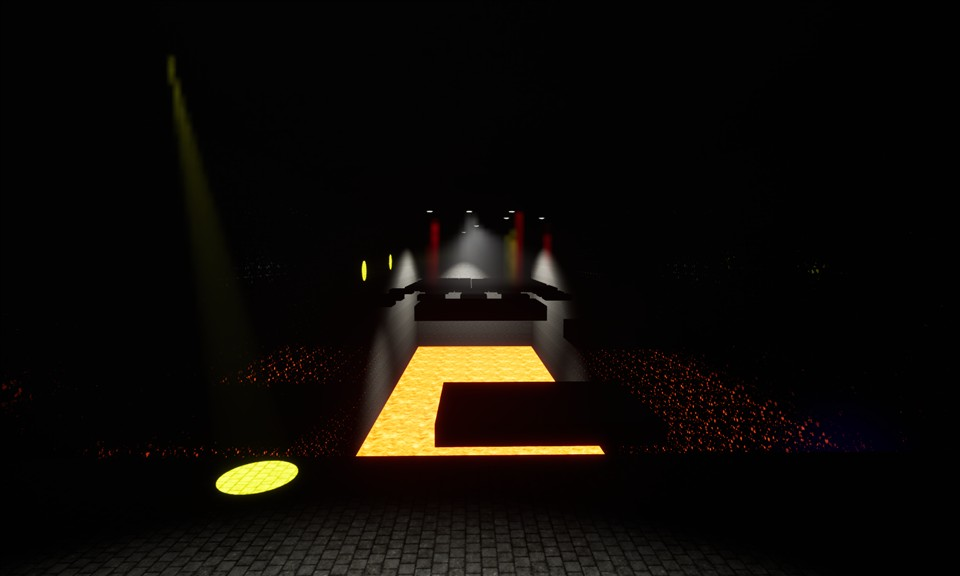

**공간 탐색 → 물체 조작 → 힌트 응시 → 퍼즐 조건 충족 → 장치 작동 → 발판·큐브 퍼즐 → 몬스터 회피 → 탈출**

## 주요 구현

### 물리 오브젝트 조작

<table><tr>
<td align="center">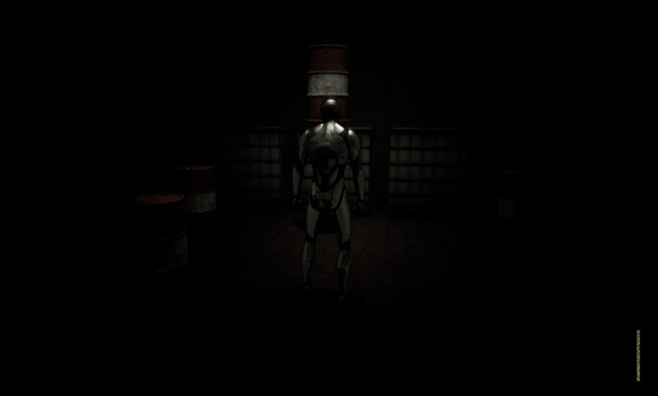 물체 탐지와 잡기</td>
<td align="center">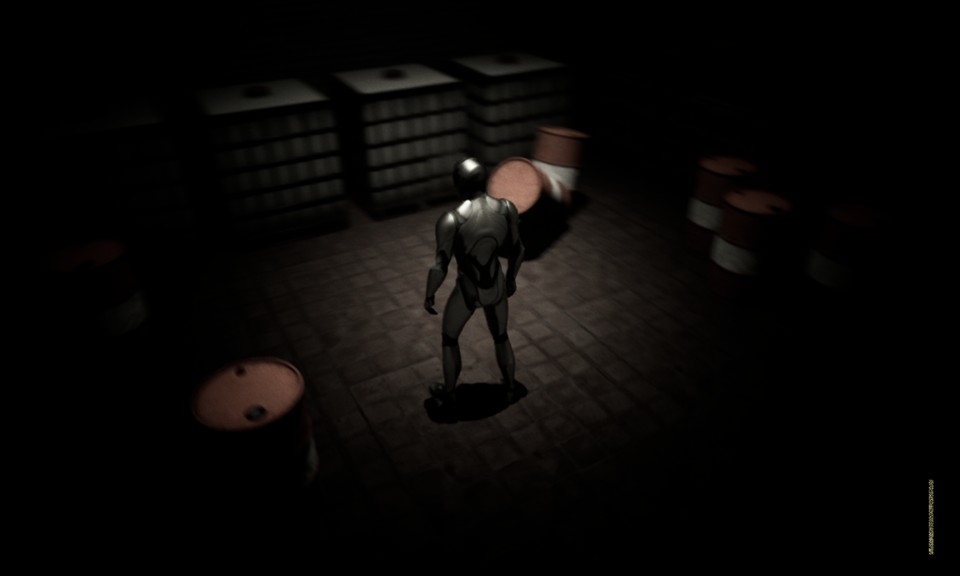 물체 이동과 해제</td>
</tr></table>

카메라 전방의 **Sphere Sweep**으로 대상을 탐지하고 **Physics Handle**에 연결. 놓을 때 물리 상태를 복구하고, 던질 때 카메라 방향 임펄스를 적용.

- **안정화:** 잡을 때 Pawn 충돌 응답과 중력, 잔여 속도를 조정하고 VInterpTo로 목표 위치를 보간.
- **상태 복구:** 놓을 때 저장한 Pawn 충돌 응답과 중력·감쇠를 복구.
- **핵심 코드:** [C_InteractionComponent.cpp](Source/EscapeGame260422/C_InteractionComponent.cpp) · Trace / Grab / TickComponent / Release / Throw

### 시선 기반 힌트

<table><tr>
<td align="center">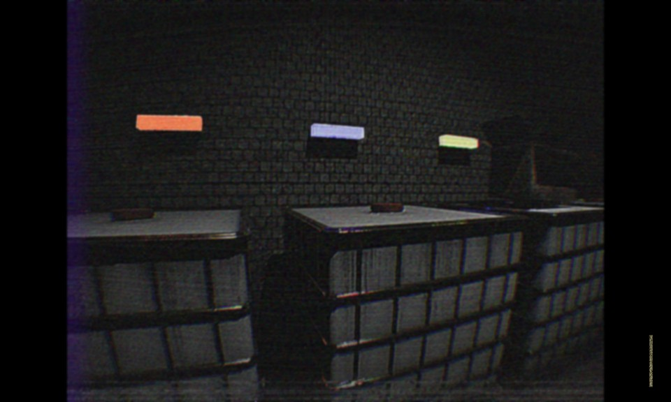 힌트 모드 · 단서 표시</td>
<td align="center">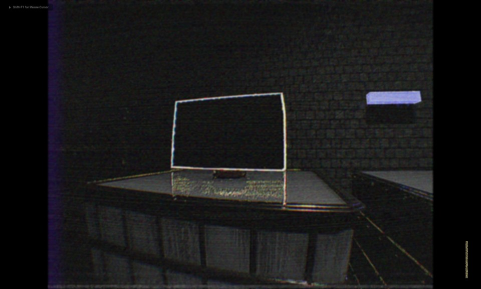 대상 응시 · 강조 표시</td>
</tr></table>

UpdateFocus에서 응시 시간을 누적하고 기준 시간에 도달하면 ActivateHint를 실행. 활성화된 힌트는 CustomDepth와 발광 재질로 강조.

- **등록과 표시:** PuzzleHighlightSubsystem에서 힌트와 조명 표시 상태 관리.
- **초기화 순서:** 힌트 등록 이후 현재 모드가 반영되도록 초기화를 다음 Tick으로 지연.
- **핵심 코드:** [InteractHintActor.cpp](Source/EscapeGame260422/InteractHintActor.cpp) · [PuzzleHighlightSubsystem.cpp](Source/EscapeGame260422/PuzzleHighlightSubsystem.cpp)

### 조건과 액션을 분리한 퍼즐

<table>
<tr><td align="center">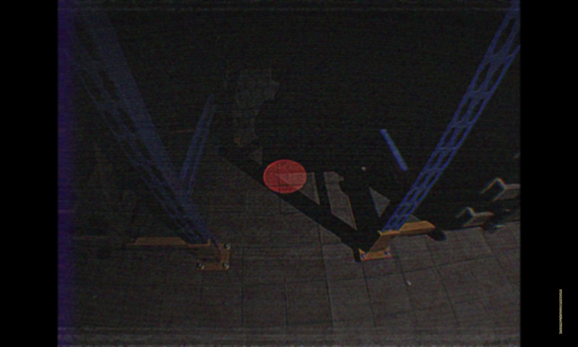 조건 영역</td>
<td align="center">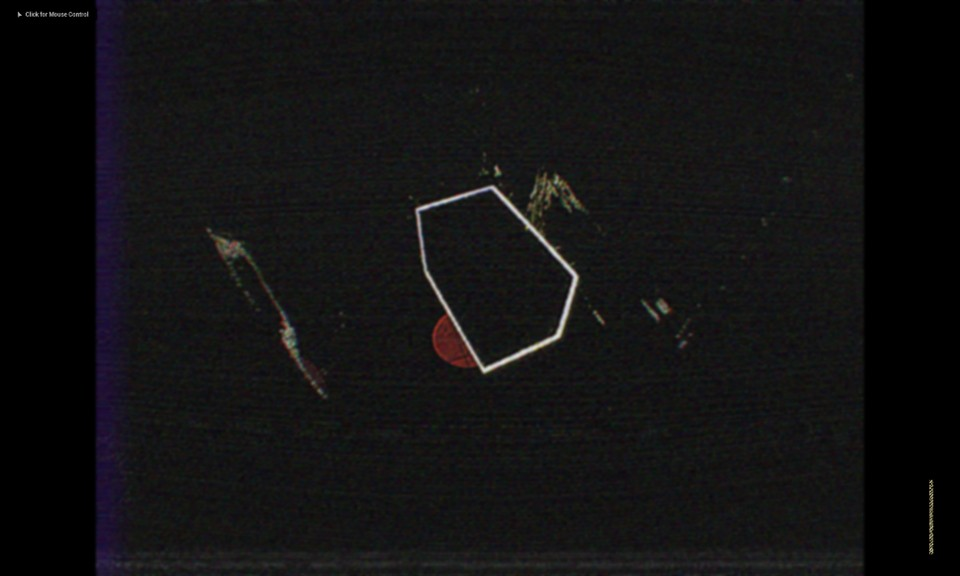 판정과 피드백</td></tr>
<tr><td align="center">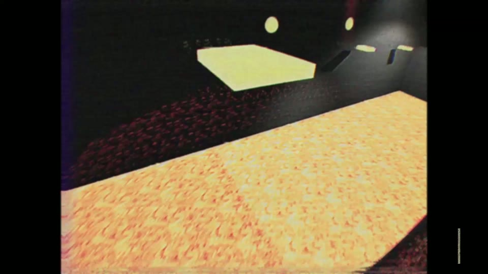 발판 퍼즐</td>
<td align="center">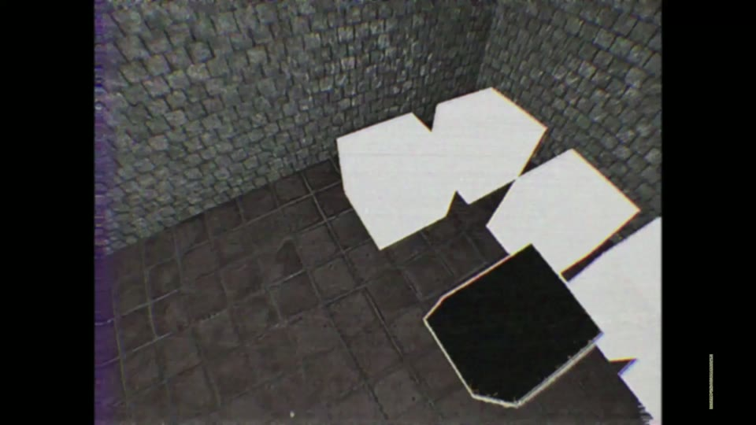 큐브와 경로 탐색</td></tr>
</table>

**Overlap / 압력판 → PuzzleTriggerActor → 조건 검사 → 연결된 액션 실행**

PuzzleTriggerActor가 연결된 조건을 검사하고 모두 충족하면 액션을 순서대로 호출. 조건과 실행 결과를 인터페이스로 분리해 겹침 판정, 점프 패드, 물리 장치를 조합.

- **겹침 조건:** OverlapCondition에서 겹친 액터의 RequiredTag 확인. 색상 큐브도 색상값이 아닌 액터 태그 기준 판정.
- **점프 패드:** 활성화 후 캐릭터가 접촉하면 LaunchCharacter에 위쪽 발사 값을 전달.
- **물리 액션:** 거리와 전파 속도로 지연을 계산한 뒤 물리 시뮬레이션과 임펄스 적용.
- **핵심 코드:** [PuzzleTriggerActor.cpp](Source/EscapeGame260422/PuzzleTriggerActor.cpp) · [OverlapCondition.cpp](Source/EscapeGame260422/OverlapCondition.cpp) · [JumpPadAction.cpp](Source/EscapeGame260422/JumpPadAction.cpp) · [PhysicsAction.cpp](Source/EscapeGame260422/PhysicsAction.cpp)

### 몬스터 추적과 피격 처리

<table>
<tr><td align="center">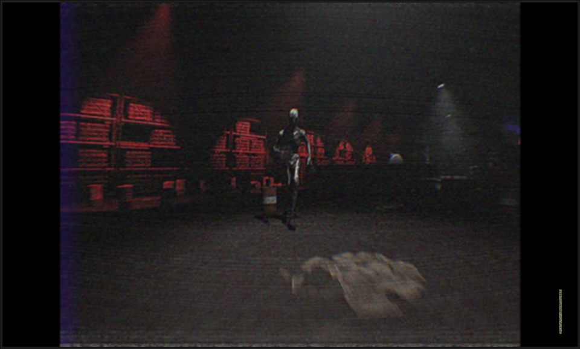 몬스터 조우</td>
<td align="center">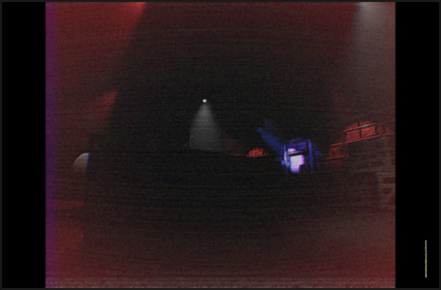 체력 변화에 따른 피격 효과</td></tr>
<tr><td align="center">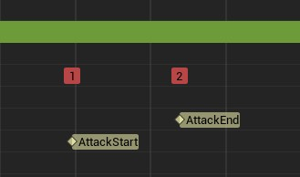 AttackStart / AttackEnd Notify</td>
<td align="center">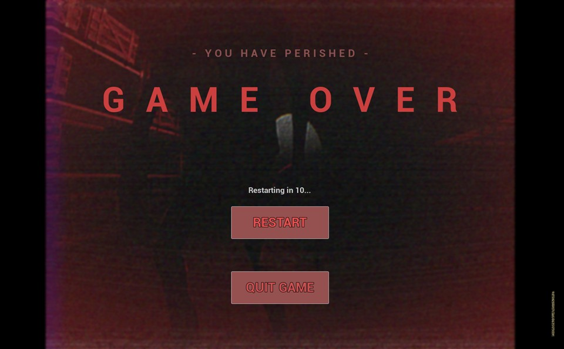 체력 소진 · 게임 오버</td></tr>
</table>

거리 감지 서비스가 Blackboard의 감지 상태와 타깃을 갱신하고, Behavior Tree가 순찰·추적 행동을 선택. 공격 애니메이션의 AttackStart / AttackEnd Notify로 공격 판정 구간을 제어.

HealthComponent의 TakeDamage는 체력을 범위 안으로 제한하고 변경 이벤트를 전달. 체력이 0에 도달하면 사망 이벤트를 호출하며, 체력 비율은 붉은 화면 효과와 연결.

- **행동 구성:** BT_Monster · BTService_DetectPlayer · BTTask_StartChase · BTTask_MonsterAttack
- **피격 코드:** [HealthComponent.cpp](Source/EscapeGame260422/HealthComponent.cpp)

### 달리기와 스태미너

이동 중 달리면 시간에 비례해 스태미너를 소모하고, 고갈 시 달리기를 해제하고 탈진 속도를 적용. 회복량은 매 Tick 계산하며 이동 속도가 낮을 때 회복 배수를 적용.

- **핵심 코드:** [EscapeGame260422Character.cpp](Source/EscapeGame260422/EscapeGame260422Character.cpp) · StartSprint / Tick / GetStaminaPercent

## 기술 구성

| 사용 기술 | 프로젝트 내 사용 |
| --- | --- |
| Unreal Engine 5.3 · C++ | 상호작용 컴포넌트, 퍼즐 조건과 액션, 힌트·체력 처리 |
| Blueprint | 몬스터 공격 판정, 애니메이션 및 UI 연결 |
| Enhanced Input | 이동과 달리기 등 플레이어 입력 |
| Physics Handle · Sweep | 오브젝트 탐지, 잡기와 이동 |
| Behavior Tree · Blackboard | 몬스터 감지, 순찰, 추적과 공격 분기 |
| AnimNotify · CustomDepth | 공격 판정 구간과 힌트 강조 표시 |

## 프로젝트 실행과 에셋

Unreal Engine 5.3 및 Visual Studio C++ 게임 개발 도구 기준. 에셋을 복원한 후 EscapeGame260422.uproject에서 프로젝트 파일을 생성하고 EscapeGame260422Editor 대상을 빌드.

저장소의 공개 에셋만으로 원본 레벨과 Blueprint 연결을 모두 재현할 수는 없습니다. 복원 방법과 외부 자료의 배포 범위는 아래 문서를 참고하세요.

- [에셋 복원 안내](Docs/Content-Restoration.md)
- [파일별 참조·배포 분류](Docs/AssetManifest.json)
- [외부 자료 출처](Docs/Third-Party-Notices.md)

기본 캐릭터 이동과 카메라는 Epic 3인칭 템플릿을 기반으로 확장.

