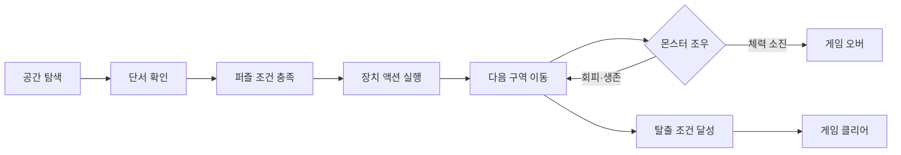

# Escape Game

### 물리 상호작용 · 시선 기반 퍼즐 · 몬스터 추격

  

창고의 단서를 찾아 환경 퍼즐을 풀고 탈출하는 3인칭 퍼즐 게임.

## 프로젝트 정보

| 항목 | 내용 |
| --- | --- |
| 개발 기간 | 4월 21일 – 5월 11일 |
| 개발 형태 | 1인 개인 프로젝트 |
| 엔진 · 언어 | Unreal Engine 5.3 · C++ · Blueprint |
| 플랫폼 | Windows PC |

## 핵심 플레이

| 시스템 | 게임 안에서의 역할 |
| --- | --- |
| 오브젝트 조작 | 물체를 들어 이동하고, 놓거나 던져 퍼즐에 활용 |
| 시선 힌트 | 힌트 모드에서 단서를 바라봐 강조 표시 활성화 |
| 환경 퍼즐 | 조건을 확인한 뒤 점프 패드·물리 장치 등 액션 실행 |
| 생존 | 달리기 스태미너 관리와 몬스터 추격 회피 |
| 게임 상태 | 피격 피드백을 거쳐 게임 오버 또는 클리어 화면 전환 |

## 게임 흐름

## 주요 구현

### 물리 오브젝트 조작

화면 중앙의 `Sphere Sweep`으로 대상을 찾고 `Physics Handle`로 잡은 물체를 이동. 놓을 때 물리 상태를 복구하고, 던질 때 카메라 방향 임펄스를 적용.

- 코드: `Source/EscapeGame260422/C_InteractionComponent.*`
- 주요 함수: `Trace()` · `Grab()` · `TickComponent()` · `Release()` · `Throw()`

### 조건·액션 기반 퍼즐

`PuzzleTriggerActor`가 연결된 조건을 검사하고, 모두 통과하면 액션을 실행. 조건과 액션을 분리해 압력판·겹침 판정과 점프 패드·물리 장치를 조합.

- 조건: `PuzzleCondition` · `OverlapCondition` · `PressurePlate`
- 액션: `PuzzleAction` · `JumpPadAction` · `PhysicsAction`

### 시선 기반 힌트

힌트 대상을 바라본 시간을 누적하고, 기준에 도달하면 `CustomDepth` 강조 효과를 적용. 힌트 등록과 조명 제어는 `PuzzleHighlightSubsystem`에서 관리.

- 코드: `InteractHintActor.cpp` · `PuzzleHighlightSubsystem`
- 주요 함수: `UpdateFocus()` · `ActivateHint()`

### 몬스터 AI와 피격 처리

Behavior Tree의 거리 검사로 순찰과 추격을 전환. 공격 애니메이션의 `AnimNotify` 구간에 공격 판정을 연결하고, 피격 시 체력과 화면 효과를 갱신.

- 에셋: `BT_Monster` · `BP_Monster` · `ABP_Monster`
- 코드: `HealthComponent.cpp`

### 스태미너와 게임 상태

달리기 중 스태미너를 소모하고 걷거나 정지하면 회복. 체력 소진과 탈출 완료를 각각 게임 오버·클리어 UI로 연결.

- 코드: `EscapeGame260422Character.cpp` · `HealthComponent.cpp`

## 코드 구성

| 기능 | 주요 파일·에셋 |
| --- | --- |
| 물리 조작 | `C_InteractionComponent.*` |
| 퍼즐 조건·액션 | `PuzzleTriggerActor.*` · `PuzzleCondition.h` · `PuzzleAction.h` |
| 압력판·겹침 판정 | `PressurePlate.*` · `OverlapCondition.*` |
| 힌트와 시각 효과 | `InteractHintActor.*` · `PuzzleHighlightSubsystem.*` |
| 플레이어 입력·스태미너 | `EscapeGame260422Character.*` |
| 몬스터 행동·공격 | `BT_Monster` · `BP_Monster` · `ABP_Monster` |
| 체력·피격 | `HealthComponent.*` |

## 프로젝트 구성 및 에셋

Unreal Engine 5.3과 Visual Studio C++ 게임 개발 도구 기준. 에셋 복원 후 `EscapeGame260422.uproject`에서 프로젝트 파일을 생성하고 `EscapeGame260422Editor` 대상을 빌드.

저장소의 공개 에셋만으로 원본 레벨과 Blueprint 연결을 모두 재현할 수는 없음. 외부 에셋의 복원·배포 범위는 아래 문서에서 확인.

- [에셋 복원 안내](Docs/Content-Restoration.md)
- [파일별 참조·배포 분류](Docs/AssetManifest.json)
- [외부 자료 출처](Docs/Third-Party-Notices.md)

기본 캐릭터 이동과 카메라는 Epic 3인칭 템플릿을 기반으로 확장. 외부 아트·애니메이션·머티리얼 팩은 자체 제작물로 표시하지 않음.

## 저장소

[KimHelpMe/EscapeGame](https://github.com/KimHelpMe/EscapeGame)

이 저장소는 개발 이후 로컬 프로젝트를 정리해 등록한 자료. 과거 Git 커밋 이력이나 실행 성능 측정 결과를 재구성하지 않음.