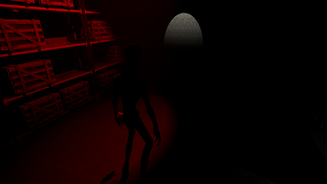

# Escape Game

물리 오브젝트 조작과 숨겨진 힌트 탐색을 결합한 Unreal Engine 개인 퍼즐 게임 프로젝트입니다.

## 프로젝트 정보

- 개발자: 엄태호 / KimHelpMe
- 개발 기간: 2026.04.21 - 2026.05.11
- 개발 인원: 1명
- 엔진 / 언어: Unreal Engine 5.3 / C++
- 개발 환경: Windows PC

## 주요 구현

- **물리 상호작용**: Sphere Sweep으로 대상을 찾고 태그·질량에 따라 잡기와 밀기를 구분합니다. PhysicsHandle로 목표 위치를 제어하고, 던지기와 착지 위치 예측을 연결합니다.
- **퍼즐 조합**: Condition / Action 인터페이스를 구현한 액터를 트리거에서 조합합니다. 압력판과 태그 조건을 문, 점프 패드, 물리 액션에 연결할 수 있습니다.
- **퍼즐 힌트**: 퍼즐 모드에서 힌트를 표시하고, 응시 시간을 MPC의 FocusRatio 값과 외곽선·머티리얼 효과에 전달합니다.
- **플레이어 상태**: 스태미나 소모·회복·탈진 상태와 체력 변경·사망 이벤트를 처리합니다.

## 코드 위치

| 기능 | 주요 파일 |
| --- | --- |
| 물리 조작·착지 예측 | `Source/EscapeGame260422/C_InteractionComponent.*` |
| 조건 판정·장치 실행 | `PuzzleTriggerActor.*`, `PuzzleCondition.h`, `PuzzleAction.h` |
| 압력판·겹침 조건 | `PressurePlate.*`, `OverlapCondition.*` |
| 장치 액션 | `DoorAction.*`, `PhysicsAction.*`, `JumpPadAction.*` |
| 힌트·시각 피드백 | `InteractHintActor.*`, `PuzzleHighlightSubsystem.*` |
| 입력·스태미나 | `EscapeGame260422Character.*` |
| 체력 | `HealthComponent.*` |

## 저장소에 포함된 에셋

게임에서 참조하는 프로젝트 데이터와 Epic 템플릿 예제 **1,825개(395.20 MiB)**를 Git LFS로 관리합니다. 외부 팩 원본과 출처 확인이 필요한 **117개**는 재배포하지 않고 복원 목록을 제공합니다.

**이 저장소만 클론한 상태에서는 원래 게임 전체를 바로 실행할 수 없습니다.** 외부 에셋 복원이 필요하며 Unreal Editor 실행·빌드 검증은 별도로 진행해야 합니다.

- [에셋 복원 방법](Docs/Content-Restoration.md)
- [파일별 참조·배포 분류](Docs/AssetManifest.json)
- [템플릿·외부 자료 출처](Docs/Third-Party-Notices.md)

## 개발 환경 구성

Unreal Engine 5.3과 Visual Studio의 C++ 게임 개발 도구를 사용합니다. `git lfs pull`로 공개 에셋을 받은 후 외부 에셋을 복원합니다. 그다음 `EscapeGame260422.uproject`의 프로젝트 파일을 생성하고 `EscapeGame260422Editor` 대상을 빌드합니다.

에셋의 포함 범위와 복원 절차는 `Docs/Content-Restoration.md`에 기록합니다. 소스만으로는 원래 레벨과 Blueprint 연결을 재현할 수 없습니다.

## 구현 범위

기본 캐릭터 이동·카메라는 Epic 3인칭 템플릿을 기반으로 확장했습니다. 외부 아트·애니메이션·머티리얼 팩은 자체 제작물로 표시하지 않습니다.

이 저장소는 개발 이후 로컬 프로젝트를 정리해 등록한 자료입니다. 과거의 Git 커밋 이력이나 실행 성능 측정 결과를 재구성하지 않았습니다.
